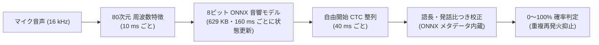

# tiny-ja-wakeword

**約 629 KB（8 ビット ONNX）で動作する、日本語オープン語彙・雑音耐性ストリーミングウェイクワード検出器**

ひらがな・カタカナで好きな言葉を指定するだけで、追加学習や外部辞書（OpenJTalk 等）なしにすぐ動作します。

本モデルは、公開されている日本語音素キーワード検出モデル [mitsu-h/icefall-ja-phoneme-kws-cv25](https://huggingface.co/mitsu-h/icefall-ja-phoneme-kws-cv25)（Zipformer Transducer・約 299 万重み・約 12 MB）をベースに蒸留して作成しました。
154 時間の日本語音声と実測の環境音・室内反響を用いてわずか **53 万重み（8 ビット ONNX 約 629 KB）** へ小型化した結果、90 分連続評価（誤通知 0.5 回/時以下）の取りこぼし率で以下の精度を達成しています。

- 元の公開モデル（[mitsu-h/icefall-ja-phoneme-kws-cv25](https://huggingface.co/mitsu-h/icefall-ja-phoneme-kws-cv25)・約 299 万重み・約 12 MB）との比較：静かな環境で **23.2% → 7.6%** へ約 1/3 に削減（モデル容量は **約 1/19**）。
- 同 Zipformer エンコーダに 2 層残差 CTC と双方向 GRU 検証器を載せた大型構成（計 **344 万重み**・約 13.6 MB）との比較：静かな環境でほぼ同等（**7.6%** 対 6.6%）、日常雑音 10 dB で **36.1% → 26.5%**、騒がしい室内 5 dB で **51.7% → 35.1%** と雑音環境では大きく上回っています。

### 主な特徴

- **超軽量・高速**：モデル本体 **628.7 KB**（8 ビット ONNX）、音声 10 秒を CPU 1 スレッドで **13.2 ms**（CPU 負荷 **0.13%**）で処理。
- **辞書ゼロ・ひらがな／カタカナで任意の語句を登録**：外部辞書や形態素解析器を使わず、ひらがな・カタカナから直接音素へ変換。
- **直感的な 0〜100% しきい値**：語長補正と確率校正を ONNX メタデータに内蔵。利用者は `threshold=0.5`（50%：標準）を選ぶだけで動作。
- **雑音・室内反響に強い**：10 dB の日常雑音環境・5 dB の騒がしい室内環境でも高精度を維持。
- **商用利用可能なオープンライセンス**：コード・モデルともに **Apache License 2.0**。

---

## 1. クイックスタート

### インストール

```bash
pip install .
```

外部辞書（OpenJTalk 等）のインストールは不要です。ウェイクワードは **ひらがな または カタカナ** で指定してください。

### ブラウザのマイクですぐ試す（デモ）

```bash
tiny-ja-wakeword-demo --open
```

または

```bash
python -m tiny_ja_wakeword.demo --open
```

ブラウザで `http://127.0.0.1:8770` が開き、マイクからのリアルタイム検出、ウェイクワードの即時変更（初期値：`オーケー、グーグル`）、0〜100% しきい値プリセット（反応重視 30%・標準 50%・厳しめ 70%）、モデル切り替え（`crnn` / `conv`）を試せます。音声は端末内だけで処理され、外部へ送信・保存されません。

### Python から 3 行で使う

```python
from tiny_ja_wakeword import Detector

detector = Detector("オーケー、グーグル", threshold=0.5)  # 0.0〜1.0（標準 0.5 = 50%）
for event in detector.feed(pcm_16k_float32):             # -1.0〜1.0 のモノラル音声配列
    print(event.phrase, f"{event.probability:.0%}", event.end_seconds)
```

複数ワードの同時待機にも対応しています。

```python
detector = Detector(["オーケー、グーグル", "ヘイ、シリ"], threshold=0.5, model="crnn")
```

> **語句の指定について**：ウェイクワードはひらがな・カタカナ（例：`オーケー、グーグル`、`ヘイ、シリ`、`おはよう`）で指定します。6 音素以上（おおよそ 3〜4 モーラ以上）の語句にすると誤通知が少なく安定します。

---

## 2. 同梱モデル一覧

2 種類の 8 ビット量子化ストリーミング ONNX モデルをパッケージに同梱しています。

| モデル名 | ファイル | 容量 | 重み数 | 10 秒処理（CPU 1 スレッド） | 特徴・向いている用途 |
|---|---|---:|---:|---:|---|
| **`crnn`**（既定） | `ja-ww-crnn-int8.onnx` | **628.7 KB** | 53.0 万 | **13.2 ms**（負荷 0.13%） | 2 次元畳み込み＋連続学習 2 層 GRU（行列積展開・8 ビット）。最も高精度で、特に雑音・反響環境に強い。PC・Raspberry Pi・スマートフォン向け。 |
| **`conv`** | `ja-ww-conv-int8.onnx` | **622.7 KB** | 51.4 万 | **14.4 ms**（負荷 0.14%） | 2 次元畳み込み＋1 次元分離畳み込み 8 層（全体静的 QDQ 8 ビット）。再帰層を持たず畳み込み命令だけで動くため、マイコン（XIAO ESP32S3 Sense 等）への移植向け。 |

---

## 3. 処理の流れ



---

## 4. 評価指標と精度比較

### 評価条件（学習データとの重複なし）

- **評価音声（`cv`）**：Common Voice 日本語 27.0 から学習話者・学習語句を完全に除いた **約 90 分の連続音声**（30 語句・各 10 話者・計 302 回の呼びかけ＋無関係な 900 発話、合計 802 話者）。
- **日常雑音＋反響（`cv-noisy-10db`）**：上記 90 分に対し、学習用と部屋・音源単位で完全に分離した OpenSLR SLR28 の実測・模擬反響と環境音、および未使用評価文の背景会話を信号対雑音比 **8〜13 dB** で合成。
- **騒がしい室内＋強い反響（`cv-noisy-5db`）**：同条件で信号対雑音比 **2〜8 dB**・反響 80%・背景会話 45% で合成。
- **未知語句の検証**：0〜100% 確率校正の重みは 30 語句を半分ずつに分けた **2 分割交差検証（完全に未知の語句）** で評価。

### 比較対象のモデル

- **公開 Transducer（約 299 万重み・約 12.0 MB）**：[mitsu-h/icefall-ja-phoneme-kws-cv25](https://huggingface.co/mitsu-h/icefall-ja-phoneme-kws-cv25) をそのまま `sherpa-onnx` の `KeywordSpotter` で実行した結果。
- **Zipformer＋ResConv CTC（330 万重み・約 13.1 MB）**：上記 Zipformer エンコーダに 2 層因果的残差 CTC ヘッドを追加した教師構成。
- **Zipformer＋ResConv＋BiGRU 検証器（344 万重み・約 13.6 MB）**：さらに双方向 GRU 検証器を組み合わせた大型構成。

### モデル別 取りこぼし率比較（低いほど良い）

| モデル | 重み数（容量） | 静かな室内 `cv`<br>（≤0.25 / ≤0.5 / ≤1 回/時） | 日常雑音 `10 dB`<br>（≤0.5 / ≤1 / ≤2 回/時） | 騒がしい室内 `5 dB`<br>（≤0.5 / ≤1 / ≤2 回/時） |
|---|---:|---:|---:|---:|
| **`tiny-ja-wakeword` `crnn`（8 ビット・0〜100% 校正・未知語句）** | **53 万（629 KB）** | **8.9% / 7.6% / 5.0%** | **26.5% / 20.9% / 16.9%** | **35.1% / 32.8% / 28.1%** |
| **`tiny-ja-wakeword` `conv`（8 ビット・0〜100% 校正・未知語句）** | **51 万（623 KB）** | 11.9% / 8.9% / 6.6% | 31.1% / 24.5% / 22.5% | 44.4% / 39.1% / 35.4% |
| 参考：Zipformer＋BiGRU 検証器（大型比較・FP32） | 344 万（約 13.6 MB） | 8.6% / 6.6% / 5.3% | 36.1% / 31.8% / 28.5% | 51.7% / 47.7% / 43.4% |
| 参考：Zipformer＋ResConv CTC（蒸留教師・FP32） | 330 万（約 13.1 MB） | 12.6% / 7.9% / 6.3% | 43.0% / 36.8% / 30.1% | 54.0% / 51.7% / 45.4% |
| 参考：[mitsu-h/icefall-ja-phoneme-kws-cv25](https://huggingface.co/mitsu-h/icefall-ja-phoneme-kws-cv25)（公開 Transducer） | 299 万（約 12.0 MB） | 23.2% / 23.2% / 20.9% | — | — |

### 0〜100% 固定プリセットの性能（`crnn` 629 KB・未知語句・個別調整なし）

語句ごとにしきい値を調整せず、固定の 0〜100% 設定をそのまま未知語句に適用した実測値です。

| プリセット（`threshold`） | 静かな室内 `cv` | 日常雑音 `10 dB` | 騒がしい室内 `5 dB` |
|---|---:|---:|---:|
| **反応重視（`0.30` / 30%）** | 取りこぼし 9.6% / 誤通知 0.22 回/時 | 取りこぼし 25.8% / 誤通知 0.58 回/時 | 取りこぼし 40.1% / 誤通知 0.33 回/時 |
| **標準（`0.50` / 50%）** | 取りこぼし 11.9% / 誤通知 0.22 回/時 | 取りこぼし 30.1% / 誤通知 0.45 回/時 | 取りこぼし 46.0% / 誤通知 0.16 回/時 |
| **厳しめ（`0.70` / 70%）** | 取りこぼし 15.6% / 誤通知 0.13 回/時 | 取りこぼし 35.4% / 誤通知 0.29 回/時 | 取りこぼし 50.3% / 誤通知 0.11 回/時 |
| **超厳格（`0.90` / 90%）** | 取りこぼし 22.5% / 誤通知 0.16 回/時 | 取りこぼし 45.0% / 誤通知 0.04 回/時 | 取りこぼし 58.6% / 誤通知 0.02 回/時 |

---

## 5. 動作端末の目安

| 端末クラス | 対応状況 | 補足 |
|---|---|---|
| PC（Windows / macOS / Linux） | そのまま動作 | Python＋ONNX Runtime で CPU 負荷 0.13%（1 スレッド） |
| Raspberry Pi 4 / 5 / Pi Zero 2 W | そのまま動作 | 辞書なし・629 KB モデルのみで常時待機可能 |
| マイコン級（Seeed Studio XIAO ESP32S3 Sense 等） | モデル規模適合（C++ 移植向け） | 8 ビット約 623 KB・約 1,720 万積和演算/秒（`conv` モデルは純畳み込み＋ReLU のみで構成） |

---

## 6. 学習データ・蒸留元・ライセンス

本リポジトリは推論用モデルと推論・デモコードのみを収録しています（学習コードは含みません）。
モデルは以下のオープンデータ・オープンモデルを用いた知識蒸留により学習しました。

- **蒸留教師**：[mitsu-h/icefall-ja-phoneme-kws-cv25](https://huggingface.co/mitsu-h/icefall-ja-phoneme-kws-cv25) の Zipformer 音響エンコーダ（Apache License 2.0）
- **音声データ**：Mozilla Common Voice 日本語 27.0（CC0、評価話者・評価語句を除外した 154.1 時間・2,880 話者）
- **環境音・室内反響**：OpenSLR SLR28 RIRS_NOISES（Apache License 2.0、点音源雑音 843 件は Freesound パブリックドメイン）

詳細な権利表記は [THIRD_PARTY_NOTICES.md](THIRD_PARTY_NOTICES.md)、本プロジェクトのライセンスは [LICENSE](LICENSE)（Apache License 2.0）をご覧ください。
